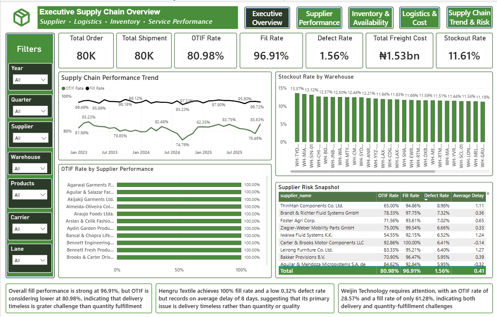
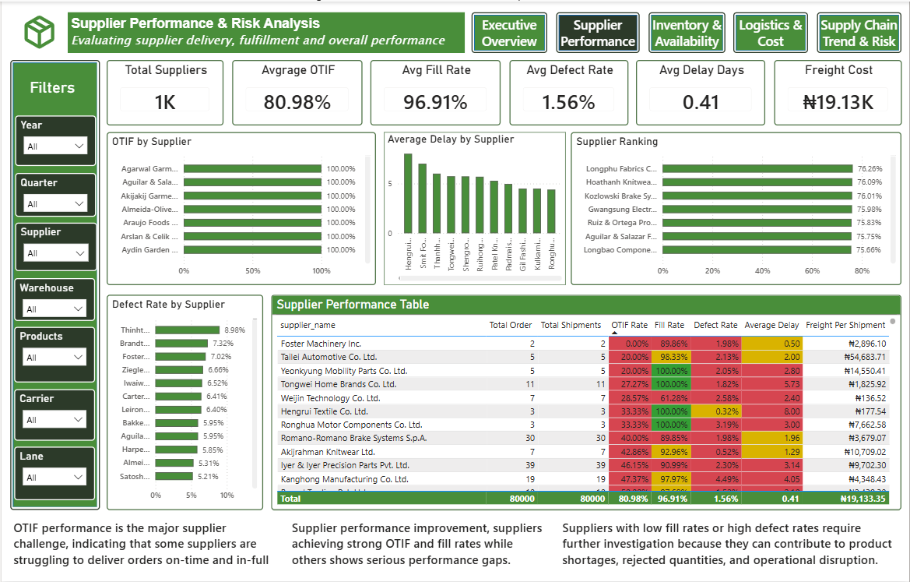
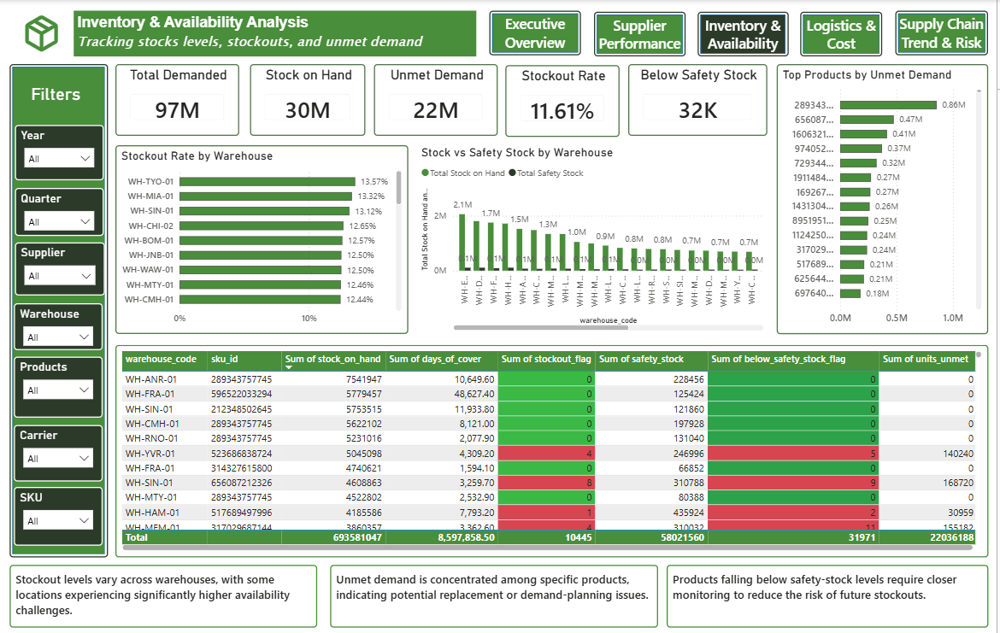
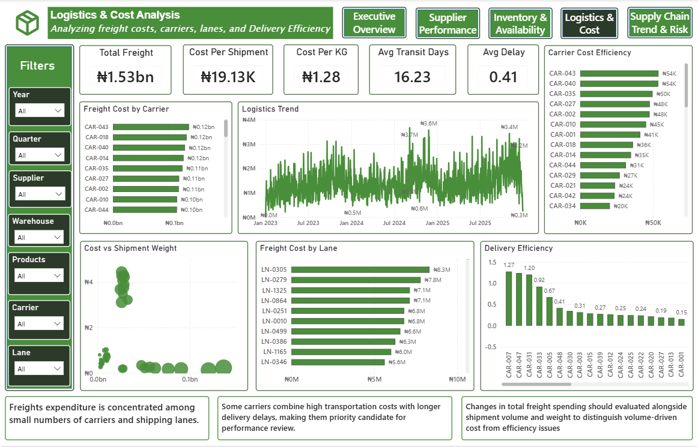
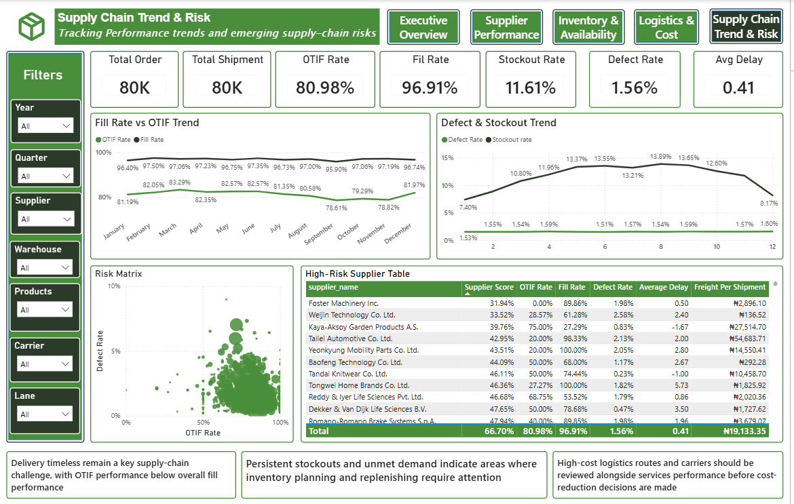

### Page 1: Supply Chain Executive Overview

### Page 2: Supplier Performance & Risk Analysis

### Page 3: Inventory & Availability Analysis

### Page 4: Logistics & Cost Analysis

### Page 5: Supply Chain Trends & Risk

